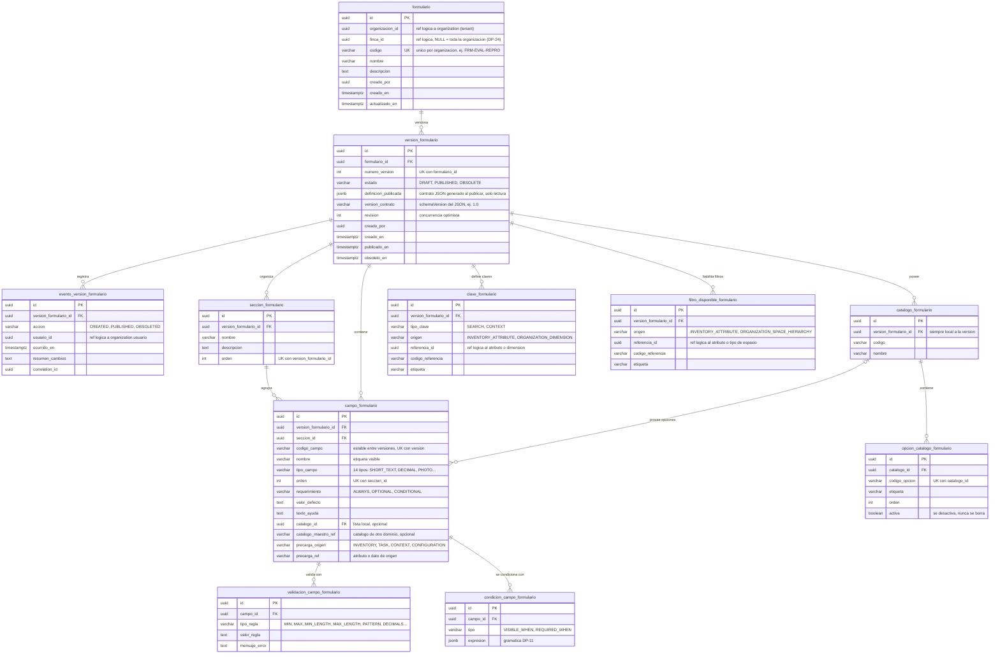

# Esquema `forms` — Formularios dinámicos

**Estado:** borrador v0 para revisión del equipo.
**Dueño:** Formularios y Planificación.
**Fuentes:** 04 v1.3 (§7–§19, §24), 10 §9–§10, skills `disenar-plantilla-formulario` y `versionar-formulario`.

## Qué guarda y qué no
- **Guarda** la definición del formulario: versiones, secciones, campos, validaciones, condiciones, catálogos
  propios, claves y filtros disponibles.
- **No guarda** tareas, población ni resultados de captura. Los resultados pasaron al esquema `planning`
  (ver [planificacion.md](planificacion.md)), porque el 10 §4 dice que Formularios no es dueño del resultado de ejecución.

## Diagrama

Imagen: [img/formularios.png](img/formularios.png) (GitHub también dibuja el bloque Mermaid de abajo).

## Reglas que el modelo debe proteger

| Regla | Cómo se protege | Fuente |
| --- | --- | --- |
| Una versión publicada no cambia | El caso de uso rechaza cambios; opcionalmente un trigger que impida `UPDATE` en hijos de versiones `PUBLICADO` | 04 §24, 10 §26 |
| Una sola numeración por formulario | `UNIQUE (formulario_id, numero_version)` | 10 §27 |
| Orden explícito y sin repetir | `UNIQUE (seccion_id, orden)`, `UNIQUE (version_formulario_id, orden)` en secciones | 04 §14 |
| Código de campo único por versión | `UNIQUE (version_formulario_id, codigo_campo)` | 04 §11 |
| Campo de selección con catálogo | `CHECK`: `SINGLE_SELECT` y `MULTI_SELECT` requieren `catalogo_id` o `catalogo_maestro_ref` | 04 §17 |
| Opciones históricas se conservan | `activa = false`, nunca `DELETE` | 04 §17 |
| Solo tipos permitidos | `CHECK tipo_campo IN (...)` con los 14 tipos | 04 §12 |
| El JSON publicado coincide con las tablas | Se genera al publicar desde las tablas; nunca se edita a mano | 04 §18, 10 §33 |

Tipos de campo (04 §12): `SHORT_TEXT`, `LONG_TEXT`, `INTEGER`, `DECIMAL`, `DATE`, `DATETIME`, `SINGLE_SELECT`,
`MULTI_SELECT`, `BOOLEAN`, `PHOTO`, `DOCUMENT`, `VIDEO`, `VOICE_NOTE`, `SIGNATURE`.

**Códigos de valores:** los estados, tipos y orígenes se guardan con los mismos códigos del contrato JSON
(skill `disenar-plantilla-formulario`) y del documento 09 (`PUBLISHED`), para que base, API y móvil hablen igual.
La etiqueta en español es solo de presentación. Los nombres de tablas y columnas siguen en español, como el resto del
equipo, hasta que se decida DP-25.

Índices: `version_formulario (formulario_id, numero_version, estado)`, `campo_formulario (version_formulario_id, orden)` (10 §27).

## Cambios respecto al borrador recibido

| # | Borrador recibido | Esta versión | Motivo |
| --- | --- | --- | --- |
| 1 | `formulario` tenía `proceso_id` y `tipo_actividad_id` | Se quitan; el proceso y la actividad viven en la tarea y como claves de contexto | D-04: el formulario no asigna procesos ni actividades (ver DP-02) |
| 2 | `formulario` tenía `estado` | El estado solo está en `version_formulario` | 04 §24: el estado es de cada versión |
| 3 | `formulario` no tenía organización ni finca | Se agregan `organizacion_id` y `finca_id` | Aislamiento por cliente (09C §14); alcance pendiente (DP-24) |
| 4 | No existían los filtros disponibles | Nueva tabla `filtro_disponible_formulario` | 04 §7 y §10: componente obligatorio |
| 5 | Condiciones mezcladas en validaciones (`REQUIRED_IF`) y sin "visible si" | Nueva tabla `condicion_campo_formulario` | 04 §15: visibilidad, obligatoriedad y validación son conceptos distintos |
| 6 | `clave_formulario.codigo_clave` texto y `esta_habilitado` | `origen` + `referencia_id` estable; se quita `esta_habilitado` | Referencias por ID estable (10 §3); una versión publicada no se habilita ni deshabilita |
| 7 | `catalogo_formulario.version_formulario_id` nulo para catálogos maestros | Solo catálogos locales; los maestros se referencian en el campo (`catalogo_maestro_ref`) | 04 §17: el maestro se referencia, no se copia |
| 8 | `origen_precarga`: `INVENTORY_ATTRIBUTE`, `PREVIOUS_VALUE` | `precarga_origen` + `precarga_ref`, con los orígenes del 04 | 04 §11: Inventario, tarea, contexto o configuración. "Valor anterior" no está definido |
| 9 | Faltaba valor por defecto | `valor_defecto` | 04 §11 |
| 10 | `tipo_campo` con valores genéricos (`TEXTO`, `NUMERO`, `SELECCION`) | Los 14 tipos exactos, con los códigos del contrato JSON | 04 §12 |
| 11 | `publicacion_formulario` solo registraba publicaciones | `evento_version_formulario` con creación, publicación y obsolescencia | 04 §24, trazabilidad |
| 12 | `resultado_ejecucion_formulario`, `valor_…` y `evidencia_…` dentro de Formularios | Se mueven a `planning` | 10 §4: Formularios no es dueño del resultado |
| 13 | `definicion_esquema` JSON sin regla | `definicion_publicada` generado al publicar y de solo lectura | Evita dos fuentes de verdad (10 §33) |

**Lo que el borrador hizo bien:** no incluyó métodos de captura, separó versión y formulario, guardó catálogos y
opciones por versión, y usó UUID.

## Pendientes que afectan este esquema
DP-02 (claves de contexto), DP-08 (mapeo campo → atributo maestro: hoy no hay columna), DP-09 (versiones
simultáneas), DP-10 (formulario para varios tipos de activo), DP-11 (gramática de `expresion`), DP-12 (unidad de
medida y límites de evidencia: hoy no hay columna), DP-24 (alcance del formulario), DP-25 (idioma de nombres).
