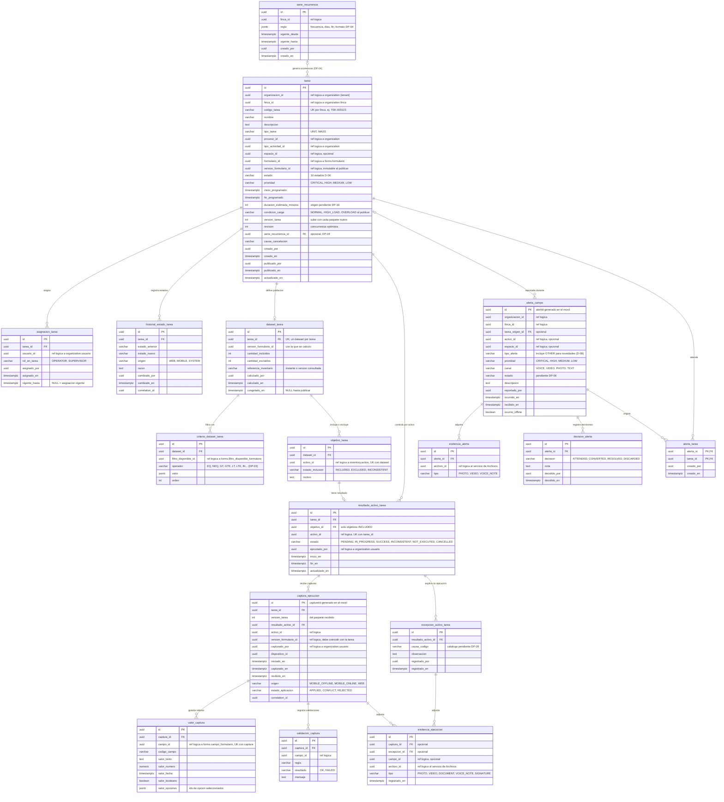

# Esquema `planning` — Planificación y ejecución

**Estado:** borrador v0 para revisión del equipo.
**Dueño:** Formularios y Planificación.
**Fuentes:** 05 v1.0, 06 §14–§23, 09C §9–§10, 10 §11–§13 y §20, skills `calcular-dataset-poblacion`,
`validar-publicacion-tarea`, `gestionar-estados-tarea`, `procesar-alerta-campo` y `procesar-sincronizacion-resultados`.

## Qué guarda y qué no
- **Guarda** la tarea, su dataset congelado, la asignación, el historial de estados, el resultado por activo, las
  capturas recibidas del campo (valores y evidencias), las excepciones y las alertas de campo.
- **No guarda** la identidad del activo (Inventario), la definición del formulario (Formularios), los paquetes ni
  los mensajes de sincronización (STAGING), ni los archivos (servicio transversal de Archivos).

## Diagrama

Imagen: [img/planificacion.png](img/planificacion.png) (GitHub también dibuja el bloque Mermaid de abajo).

### Estados de la tarea (D-06) — códigos propuestos
| Estado oficial | Código |
| --- | --- |
| Borrador | `DRAFT` |
| Validada | `VALIDATED` |
| Programada | `SCHEDULED` |
| Disponible para campo | `AVAILABLE_FOR_FIELD` |
| En ejecución | `IN_PROGRESS` |
| Pausada | `PAUSED` |
| Finalizada | `FINISHED` |
| Por validar | `PENDING_VALIDATION` |
| Cerrada | `CLOSED` |
| Cancelada | `CANCELLED` |

No existen como estado: Aceptada, En desplazamiento, Vencida (Vencida es un indicador de cumplimiento).

## Reglas que el modelo debe proteger

| Regla | Cómo se protege | Fuente |
| --- | --- | --- |
| Solo estados oficiales | `CHECK estado IN (...)` con los 10 códigos | D-06 |
| Transiciones válidas | Máquina de estados en el dominio + fila en `historial_estado_tarea` por cada cambio | 05 §35 |
| Versión del formulario fija | El caso de uso rechaza cambiar `version_formulario_id` después de publicar | 10 §16 |
| Dataset congelado | `dataset_tarea.congelado_en` no nulo al publicar; luego no se editan `objetivo_tarea` | 05 regla 17 |
| Un resultado por activo y tarea | `UNIQUE (tarea_id, activo_id)` en `resultado_activo_tarea` | 05 regla 19 |
| Captura sin duplicados | `captura_ejecucion.id` = `captureId` del móvil (PK) | 09C §9, CI-009 |
| Un valor por campo y captura | `UNIQUE (captura_id, campo_id)` en `valor_captura` | 10 §11 |
| No ejecutado o cancelado con causa | Un caso de uso exige `excepcion_activo_tarea` para esos estados | 05 regla 22 |
| La alerta no se cierra al crear la tarea | La relación vive en `alerta_tarea`; el estado de la alerta cambia solo por `decision_alerta` | 05 §25 |
| Código de tarea único por finca | `UNIQUE (finca_id, codigo_tarea)` | — |

Índices (10 §27): `tarea (finca_id, estado, inicio_programado)`, `asignacion_tarea (usuario_id, vigente_hasta)`,
`objetivo_tarea (dataset_id, activo_id)`, `resultado_activo_tarea (tarea_id, estado)`,
`captura_ejecucion (tarea_id)`, `captura_ejecucion (activo_id, capturado_en)`, `alerta_campo (finca_id, estado, prioridad)`.

## Cambios respecto al borrador recibido

| # | Borrador recibido | Esta versión | Motivo |
| --- | --- | --- | --- |
| 1 | `objetivo_tarea.captura_criterios` (JSON repetido en cada activo) | Criterios a nivel de tarea en `dataset_tarea` + `criterio_dataset_tarea` | Los criterios son del dataset, no de cada activo (05 §12); se pueden consultar |
| 2 | No se registraba cuándo se calculó ni cuándo se congeló el dataset | `dataset_tarea` con cantidades, fechas y referencia a Inventario | Trazabilidad del dataset (05 regla 17, 10 §12) |
| 3 | `estado` "BORRADOR, PROGRAMADA, EN_EJECUCION, etc." | Los 10 estados exactos | D-06 |
| 4 | Sin `version_tarea` ni `revision` | Agregadas | Paquetes nuevos y concurrencia (09C §10.4, 10 §16) |
| 5 | Sin condición de carga ni datos de publicación | `condicion_carga`, `publicado_por`, `publicado_en` | 05 §14: registrar la condición de carga |
| 6 | `motivo_cancelacion` como texto en el resultado | Tabla `excepcion_activo_tarea` con causa, observación y evidencias | 05 §18: causa y, según el caso, observación o evidencia |
| 7 | Estados del resultado incompletos ("EJECUTADO_EXITO, CANCELADO, etc.") | 6 estados exactos | 10 §13, 06 §14 |
| 8 | Sin tiempos por activo | `inicio_en` y `fin_en` | 06 §23: tiempos por activo |
| 9 | Valores, evidencias y resultados de captura estaban en Formularios | `captura_ejecucion`, `valor_captura`, `validacion_captura`, `evidencia_ejecucion` en `planning` | 10 §4: el resultado no es de Formularios |
| 10 | `valor_tipado` como texto | Columnas tipadas (texto, número, fecha, sí/no, opciones) | Permite filtrar y calcular indicadores sin convertir texto |
| 11 | Captura sin identificador del móvil | `captura_ejecucion.id` = `captureId` | Idempotencia en la sincronización (09C §9) |
| 12 | `alerta_campo.tarea_convertida_id` (una sola tarea) | Tabla `alerta_tarea` (una alerta puede originar varias tareas) | 10 §20: `alert_task_link` |
| 13 | Estado de alerta "ABIERTA, ATENDIDA, RESUELTA, DESCARTADA" fijo | Historial en `decision_alerta`; el estado queda pendiente | DP-06 |
| 14 | Alerta sin evidencias, canal ni hora de recepción | `evidencia_alerta`, `canal`, `recibido_en`, `ocurrio_offline` | 06 §18–§19, 09C §10.6 |
| 15 | `regla_recurrencia` JSON en la tarea | Tabla `serie_recurrencia`; cada ocurrencia es una tarea | 05 §26: trazabilidad de cada instancia (forma final según DP-04) |
| 16 | Asignación sin historial | `asignado_por` y `vigente_hasta` | Reasignaciones trazables (DP-17) |
| 17 | FK físicas hacia Organización, Inventario y Formularios | Referencias lógicas sin FK | CONST §10 |

**Lo que el borrador hizo bien:** tarea con versión de formulario, separación unitaria y masiva, historial de estados,
inclusión y exclusión en el objetivo, resultado por activo y vínculo alerta → tarea.

## Pendientes que afectan este esquema
DP-03 (operadores de `criterio_dataset_tarea`), DP-04 (`serie_recurrencia`), DP-05 (transiciones), DP-06 (estado de
la alerta y si `alerta_campo` vive en este esquema), DP-16 (duración y carga), DP-17 (reasignación), DP-18 (recapturas:
hoy se permiten varias capturas por resultado), DP-20 (catálogo de causas), DP-22 (si las capturas van en `planning` o
en un esquema de ejecución), DP-25 (idioma de nombres).
