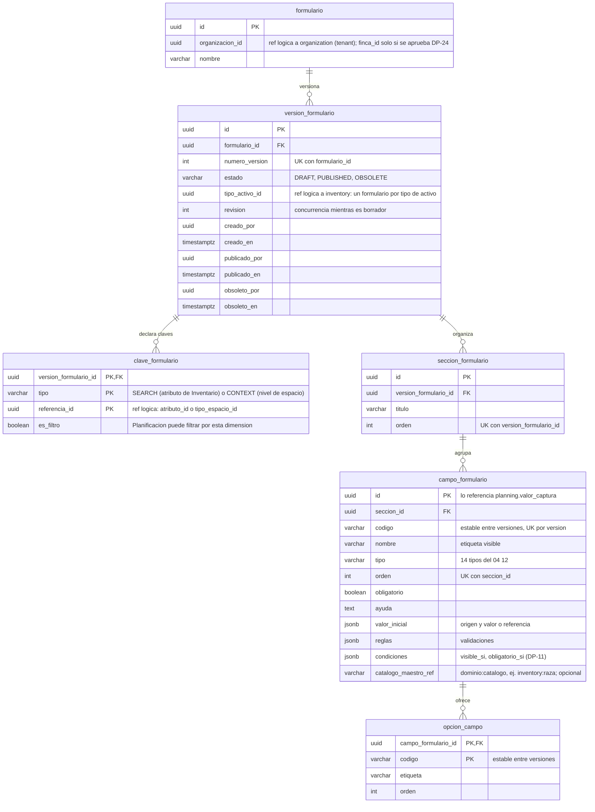

# Esquema `forms` — Formularios dinámicos

**Estado:** borrador v1.1 (2026-11-10), acordado por el responsable del módulo. Parte del v1 (2026-11-09, ejercicio con
el formulario «Pesaje») más la auditoría del 2026-11-10 (ver «Cambios de la v1.1»). Reemplaza al v0 (11 tablas) y a la
propuesta de 8 tablas del mockup. Total: 6 tablas y 39 columnas.
**Dueño:** Formularios y Planificación.
**Fuentes:** 04 v1.3 (§7–§19, §24), 10 §9–§10, 09C §10.3–§10.4, skills `disenar-plantilla-formulario` y
`versionar-formulario`.

## Qué guarda y qué no
- **Guarda** la definición versionada del formulario: el tipo de activo al que aplica, las claves de búsqueda y de
  contexto (con su marca de filtro), las secciones, los campos con sus validaciones, condiciones y precarga, y las
  opciones locales de los campos de selección.
- **No guarda** tareas, población ni resultados de captura (esquema `planning`, ver [planificacion.md](planificacion.md)),
  ni nombres o valores de maestros de Inventario u Organización: solo sus referencias.

## Diagrama (6 tablas)

## Detalle de las columnas que necesitan explicación

| Tabla.columna | Contenido | Fuente |
| --- | --- | --- |
| `version_formulario.tipo_activo_id` | Tipo de activo sobre el que se ejecuta el formulario. Planificación lo usa para pedir la población a Inventario. Un formulario por tipo de activo | DP-10 (acordado) |
| `clave_formulario.tipo` | `SEARCH`: atributo que Inventario publica como apto para búsqueda (RFID, Sexo, Edad). `CONTEXT`: nivel de la jerarquía de espacios de Organización (Potrero). Proceso y tipo de actividad **no** se declaran: toda tarea los tiene | 04 §8–§9, DP-02 (acordado) |
| `clave_formulario.es_filtro` | `true` si Planificación puede usar la dimensión en los criterios del dataset. RFID suele ser `false` | 04 §10, DP-02 (acordado) |
| `campo_formulario.codigo` | Código legible (`peso_kg`) que se conserva al crear una versión nueva. Lo usan las condiciones entre campos, las reglas de Knowledge y la comparación de resultados entre versiones | 04 §11, §24 |
| `campo_formulario.valor_inicial` | `{"origen": "CONFIGURATION", "valor": ...}`, `{"origen": "INVENTORY", "atributo_id": ...}`, `{"origen": "TASK", ...}` o `{"origen": "CONTEXT", ...}` | 04 §11 |
| `campo_formulario.reglas` | Validaciones según el tipo: `min`, `max`, `decimals`, `minLength`, `maxLength`, `pattern`, `minSelected`, `maxSelected`, `minCount`, `maxCount` | 04 §16 |
| `campo_formulario.condiciones` | `{"visible_si": {...}, "obligatorio_si": {...}}`. La obligatoriedad condicional y la evidencia requerida por condición se expresan aquí. Gramática en DP-11 | 04 §13, §15 |
| `campo_formulario.catalogo_maestro_ref` | Catálogo de otro dominio, con el dominio dueño incluido: `inventory:raza`. Se consume por contrato de ese dominio. Si es nulo, el campo de selección usa sus filas de `opcion_campo` | 04 §17, 08 §11 |
| `opcion_campo.codigo` | Código estable de la opción (`normal`); junto con el campo forma la PK. Es lo que guarda `planning.valor_captura`, por eso la opción no necesita `id` | 04 §17 |
| `version_formulario.obsoleto_por` / `obsoleto_en` | Quién y cuándo marcó la versión como obsoleta, igual que `publicado_por` / `publicado_en`. Quién puede hacerlo: DP-09 y DP-23 | 04 §24, 10 §16 |

Tipos de campo (04 §12): `SHORT_TEXT`, `LONG_TEXT`, `INTEGER`, `DECIMAL`, `DATE`, `DATETIME`, `SINGLE_SELECT`,
`MULTI_SELECT`, `BOOLEAN`, `PHOTO`, `DOCUMENT`, `VIDEO`, `VOICE_NOTE`, `SIGNATURE`.

## Reglas que el modelo debe proteger

| Regla | Cómo se protege | Fuente |
| --- | --- | --- |
| Una versión publicada no cambia | El caso de uso rechaza cambios; opcionalmente un trigger impide `UPDATE` y `DELETE` en las tablas hijas de versiones `PUBLISHED` u `OBSOLETE` | 04 §24, 10 §26 |
| Una sola numeración por formulario | `UNIQUE (formulario_id, numero_version)` | 10 §27 |
| Solo tipos y estados permitidos | `CHECK` en `estado`, `clave_formulario.tipo` y `campo_formulario.tipo` | 04 §12, §24 |
| Una dimensión una sola vez por versión | PK `(version_formulario_id, tipo, referencia_id)` | 04 §8–§10 |
| Solo claves aptas | Al guardar, se verifica por contrato que Inventario publique el atributo como apto y que Organización tenga el nivel de espacio | 04 §8 |
| Orden explícito y sin repetir | `UNIQUE (version_formulario_id, orden)` en secciones; `UNIQUE (seccion_id, orden)` en campos | 04 §14 |
| Código de campo único por versión | El caso de uso lo valida (el campo llega a la versión por su sección) | 04 §11 |
| Opción única por campo | PK `(campo_formulario_id, codigo)` | 04 §17 |
| Campo de selección con opciones | `SINGLE_SELECT` y `MULTI_SELECT` exigen `catalogo_maestro_ref` o al menos una fila en `opcion_campo` (validación al publicar) | 04 §17 |
| Opciones históricas se conservan | Las opciones son de cada versión. «Desactivar» una opción es no copiarla a la versión siguiente; la versión anterior la conserva | 04 §17 |
| Publicar exige tipo de activo | `tipo_activo_id` no nulo para pasar a `PUBLISHED` | DP-10 (acordado) |

**Nueva versión:** se copian claves, secciones y campos con ids nuevos, y las opciones con los mismos `codigo`.
**Contrato hacia Planificación y Mobile:** se genera desde estas tablas al consultarlo; la versión publicada es
inmutable, así que no hace falta guardar una copia JSON.

Índices: `version_formulario (formulario_id, numero_version, estado)`, `campo_formulario (seccion_id, orden)` (10 §27).

**Códigos de valores:** estados, tipos y orígenes usan los mismos códigos del contrato JSON y del documento 09
(`PUBLISHED`, `SHORT_TEXT`). Los nombres de tablas y columnas siguen en español hasta que se decida DP-25.

## Ejemplo: formulario «Pesaje», versión 1

| Tabla | Filas |
| --- | --- |
| `formulario` | frm-01 «Pesaje» |
| `version_formulario` | ver-01: versión 1, `PUBLISHED`, tipo de activo Bovino, sin `obsoleto_por` |
| `clave_formulario` | (`SEARCH`, RFID, no filtro) · (`SEARCH`, Sexo, filtro) · (`SEARCH`, Edad, filtro) · (`CONTEXT`, nivel Potrero, filtro) |
| `seccion_formulario` | sec-01 «Pesaje», orden 1 |
| `campo_formulario` | `peso_kg` «Peso (kg)», `DECIMAL`, obligatorio, reglas `{min: 50, max: 1000}` · `condicion_corporal` «Condición corporal», `SINGLE_SELECT`, obligatorio |
| `opcion_campo` | `flaca` «Flaca» · `normal` «Normal» · `gorda` «Gorda» |

## Bloques de columnas

Las columnas de cada tabla se pueden leer por bloques (el orden del diagrama es el mismo):

| Tabla | Bloque | Columnas |
| --- | --- | --- |
| `formulario` | Identidad | `id`, `organizacion_id`, `nombre` |
| `version_formulario` | Identidad | `id`, `formulario_id`, `numero_version` |
| | Definición | `estado`, `tipo_activo_id`, `revision` |
| | Ciclo de vida | `creado_por`, `creado_en`, `publicado_por`, `publicado_en`, `obsoleto_por`, `obsoleto_en` |
| `clave_formulario` | Clave | `version_formulario_id`, `tipo`, `referencia_id` |
| | Uso | `es_filtro` |
| `seccion_formulario` | Todo | `id`, `version_formulario_id`, `titulo`, `orden` |
| `campo_formulario` | Identidad y lugar | `id`, `seccion_id`, `codigo`, `orden` |
| | Qué se captura | `nombre`, `tipo`, `ayuda`, `catalogo_maestro_ref` |
| | Comportamiento | `obligatorio`, `valor_inicial`, `reglas`, `condiciones` |
| `opcion_campo` | Todo | `campo_formulario_id`, `codigo`, `etiqueta`, `orden` |

## Cambios respecto al v0 y a la propuesta del mockup

| # | Antes | Ahora | Motivo |
| --- | --- | --- | --- |
| 1 | El formulario no decía a qué tipo de activo aplica | `version_formulario.tipo_activo_id` | Sin él Planificación no puede pedir la población (ejercicio «Pesaje», DP-10) |
| 2 | Claves de búsqueda, claves de contexto y filtros disponibles en tablas separadas | Una tabla `clave_formulario` con `tipo` y `es_filtro` | 04 §10: los filtros «no son un maestro independiente»; se construyen sobre las claves |
| 3 | Proceso y tipo de actividad como claves de contexto | No se declaran; la tarea siempre los tiene | D-04 y 05 §10 (DP-02) |
| 4 | Nombre o etiqueta copiados en cada clave | Solo la referencia | No duplicar maestros (CONST §22 regla 5) |
| 5 | Claves y filtros con `id` propio | PK compuesta; los criterios de la tarea apuntan a la dimensión maestra | Los ids de fila cambian en cada versión; el id del atributo no |
| 6 | Validaciones y condiciones en tablas propias | `reglas` y `condiciones` (jsonb) en el campo | Son reglas variables; la convención permite JSONB para reglas y condiciones |
| 7 | Catálogo local como tabla aparte | Opciones directamente en `opcion_campo`; catálogo maestro por referencia | Un catálogo local pertenece a un solo campo |
| 8 | `opcion_campo.activa` | Se quita | La versión publicada no cambia; la desactivación ocurre al crear la versión siguiente |
| 9 | Sin código estable en campos y opciones (mockup) | `codigo` en ambos | Condiciones, reglas de Knowledge y comparación entre versiones |
| 10 | `valor_inicial` solo literal (mockup) | `valor_inicial` con origen | 04 §11: contexto, Inventario, tarea o configuración |
| 11 | Sin ayuda ni condiciones (mockup) | `ayuda` y `condiciones` | 04 §11, §15 |
| 12 | Tabla de eventos de la versión y JSON publicado (v0) | Columnas de creación, publicación y obsolescencia; sin copia JSON | Cada evento ocurre una vez; la versión publicada es inmutable |
| 13 | `formulario.creado_por` y `creado_en` | Se quitan | La creación del formulario es la creación de su versión 1 |

## Cambios de la v1.1 (auditoría del 2026-11-10)

| # | v1 | v1.1 | Motivo |
| --- | --- | --- | --- |
| 1 | `catalogo_maestro_id` (uuid) | `catalogo_maestro_ref` (`dominio:catalogo`) | Un uuid solo no dice de qué dominio es el catálogo; el 08 exige consumirlo por contrato de su dueño |
| 2 | `version_formulario.obsoleto_en` sin actor | Se agrega `obsoleto_por` | Creación y publicación ya tenían actor (10 §16) |
| 3 | `opcion_campo.id` | PK `(campo_formulario_id, codigo)` | Nada referencia el id: las capturas guardan el código (reducción acordada) |

## Pendientes que afectan este esquema
DP-08 (mapeo campo → atributo maestro: hoy no hay columna), DP-09 (versiones simultáneas y quién obsoleta), DP-11
(gramática de `condiciones`), DP-12 (unidad de medida y límites de evidencia: hoy no hay columna), DP-24 (alcance:
`finca_id`), DP-25 (idioma de nombres), DP-26 (estructuras no estandarizables).
DP-02 y DP-10 quedan acordadas por el responsable del módulo, pendientes de confirmación de Producto.
