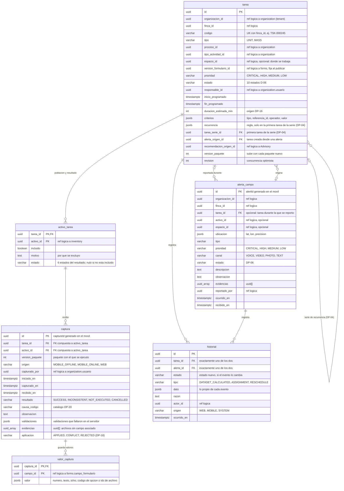

# Esquema `planning` — Planificación y ejecución

**Estado:** borrador v1 (2026-11-09), acordado por el responsable del módulo después del ejercicio con el formulario
«Pesaje». Reemplaza al v0 (17 tablas).
**Dueño:** Formularios y Planificación.
**Fuentes:** 05 v1.0, 04 §21–§23, 06 §14–§23, 09C §9–§10, 10 §11–§13, §16, §19–§20 y §34, skills
`calcular-dataset-poblacion`, `validar-publicacion-tarea`, `gestionar-estados-tarea`, `procesar-alerta-campo`,
`construir-paquete-trabajo` y `procesar-sincronizacion-resultados`.

## Qué guarda y qué no
- **Guarda** la tarea con su contexto, programación, criterios y origen; la población con el resultado por activo;
  las capturas recibidas del campo con sus valores; las alertas de campo; y un historial único de tareas y alertas.
- **No guarda** la identidad ni los atributos del activo (Inventario), la definición del formulario (Formularios), el
  paquete ni los mensajes (STAGING), los archivos (servicio de Archivos), las reglas (Knowledge) ni la posición (Track)
  (05 §36). Tampoco guarda indicadores: se calculan con estas tablas (05 §35, 10 §19).

## Diagrama (6 tablas)

`uuid_array` representa el tipo `uuid[]` de PostgreSQL (Mermaid no acepta corchetes en el tipo).

## Detalle de las columnas que necesitan explicación

| Tabla.columna | Contenido | Fuente |
| --- | --- | --- |
| `tarea.espacio_id` | **Dónde se trabaja** (contexto del resultado). Debe ser del nivel que pide la clave `CONTEXT` del formulario. No filtra la población: los animales del P-03 pueden pesarse en el corral | 04 §9, §22; 09C §10.4 |
| `tarea.criterios` | `[{"tipo": "SEARCH", "referencia_id": "<atributo>", "operador": "EQ", "valor": ...}, {"tipo": "CONTEXT", "referencia_id": "<espacio>", "operador": "EQ"}]`. Solo dimensiones con `es_filtro` en la versión. Se guarda la dimensión maestra, no el id de fila de `forms`, para que sobreviva a un cambio de versión en borrador. Operadores y combinación: DP-03 | 04 §10, 05 §12 |
| `tarea.recurrencia`, `tarea.tarea_serie_id` | La primera tarea guarda la regla; cada ocurrencia es una tarea con su propio dataset y apunta a la primera. Sujeto a DP-04 | 05 §26 |
| Origen de la tarea | Manual si `alerta_origen_id` y `recomendacion_origen_id` son nulos. Una alerta puede originar varias tareas | 05 §25, 10 §20, §34 |
| `activo_tarea` | Una fila por activo evaluado. Incluidos con su resultado; excluidos con su motivo (por ejemplo, «sin fecha de nacimiento»). Las cantidades se cuentan aquí | 05 §12, §17 |
| `captura` | Cada reporte del móvil por activo, también la no ejecución o cancelación. El contexto es el de la tarea, no se repite. La versión del formulario es la de la tarea: se valida al recibir y no se guarda | 05 §18–§19, 09C §10.5 |
| `captura.resultado` / `aplicacion` / `activo_tarea.estado` | Lo que reportó el operador / si la captura cuenta / el resultado consolidado del activo | 05 §17, DP-18 |
| `captura.evidencias` | Evidencia que no pertenece a un campo, como la foto que justifica una cancelación. Las fotos de un campo `PHOTO` son su valor en `valor_captura` | 04 §13, 05 §18 |
| `valor_captura.valor` | Valor tipado en JSON: `432.5`, `"normal"` (código de la opción), `true`, `["<archivo_id>"]` | 10 §11 |
| `historial.estado` / `historial.tipo` | Si el evento cambia el estado, se llena `estado`. Si no lo cambia, se llena `tipo`. `CHECK (estado IS NOT NULL OR tipo IS NOT NULL)` | 05 §35, 10 §16 |

### Qué guarda `historial.dato` en cada evento

| Evento | Cómo se registra | `dato` |
| --- | --- | --- |
| Creación de la tarea | `estado = DRAFT` | — |
| Cálculo del dataset | `tipo = DATASET_CALCULATED` | Instante consultado a Inventario, incluidos y excluidos |
| Asignación o reasignación | `tipo = ASSIGNMENT` | Responsable anterior y nuevo; versión de paquete si se regenera (DP-17) |
| Reprogramación | `tipo = RESCHEDULE` | Fechas anteriores; versión de paquete si se regenera (DP-17) |
| Validación previa | `estado = VALIDATED` | Advertencias del resumen (05 §13) |
| Publicación | `estado = SCHEDULED` o `AVAILABLE_FOR_FIELD` (DP-05) | Condición de carga (05 §14) y versión del paquete |
| Ejecución en campo | `estado = IN_PROGRESS`, `PAUSED`, `FINISHED`, origen `MOBILE` | — |
| Control y cierre | `estado = PENDING_VALIDATION`, `CLOSED` | — |
| Cancelación | `estado = CANCELLED` | — (la causa va en `razon`) |
| Decisiones sobre la alerta | `estado = ATTENDED`, `CONVERTED`, `RESOLVED`, `DISCARDED` (DP-06) | — |

Quién creó o publicó una tarea, cuándo empezó y cuándo terminó realmente se obtiene de este historial; por eso
`tarea` no tiene esas columnas. La recepción de una alerta no se registra aquí: ya está en `alerta_campo.recibido_en`.

### Estados de la tarea (D-06)
| Estado oficial | Código |
| --- | --- |
| Borrador | `DRAFT` |
| Validada | `VALIDATED` |
| Programada | `SCHEDULED` |
| Disponible para campo | `AVAILABLE_FOR_FIELD` |
| En ejecución | `IN_PROGRESS` |
| Pausada | `PAUSED` |
| Finalizada | `FINISHED` |
| Por validar | `PENDING_VALIDATION` |
| Cerrada | `CLOSED` |
| Cancelada | `CANCELLED` |

No existen como estado: Aceptada, En desplazamiento, Vencida (Vencida es un indicador de cumplimiento).
Estados del resultado por activo (10 §13): `PENDING`, `IN_PROGRESS`, `SUCCESS`, `INCONSISTENT`, `NOT_EXECUTED`,
`CANCELLED`.

## Reglas que el modelo debe proteger

| Regla | Cómo se protege | Fuente |
| --- | --- | --- |
| Solo estados oficiales | `CHECK` en `tarea.estado`, `activo_tarea.estado`, `captura.resultado` | D-06, 10 §13 |
| Transiciones válidas | Máquina de estados en el dominio + fila en `historial` por cada cambio | 05 §35, DP-05 |
| Formulario publicado | Al crear o validar se verifica por contrato que la versión esté `PUBLISHED` | 05 regla 13 |
| Versión y dataset fijos al publicar | El caso de uso rechaza cambios en `version_formulario_id`, `criterios` y `activo_tarea.incluido` después de `VALIDATED`; trigger opcional | 05 reglas 17 y 29, 10 §16 |
| Criterios permitidos | Cada criterio debe ser una dimensión con `es_filtro` en la versión de la tarea | 04 §10 |
| Contexto válido | Si el formulario tiene una clave `CONTEXT`, `espacio_id` debe ser de ese nivel | 04 §9, §22 |
| Responsable y dataset antes de publicar | Validación previa: `responsable_id` no nulo; en `MASS`, un `DATASET_CALCULATED` y filas incluidas | 05 reglas 14 y 15 |
| Un resultado por activo y tarea | PK `(tarea_id, activo_id)` | 05 regla 19 |
| Resultado solo para incluidos | `CHECK ((incluido AND estado IS NOT NULL) OR (NOT incluido AND estado IS NULL))` | 05 §17 |
| Capturas y alertas sin duplicados | `captura.id` = `captureId`, `alerta_campo.id` = `alertId` | 09C §9, 10 §34 |
| Solo activos del dataset | FK compuesta `captura (tarea_id, activo_id)` → `activo_tarea`; además debe estar incluido | D-09, 05 regla 18 |
| Un valor por campo y captura | PK `(captura_id, campo_id)` | 10 §11 |
| No ejecutado o cancelado con causa | `CHECK (resultado NOT IN ('NOT_EXECUTED','CANCELLED') OR causa_codigo IS NOT NULL)`. Observación o evidencia obligatorias según el catálogo de causas (DP-20) | 05 §18, regla 22 |
| Historial de una sola entidad | `CHECK` exactamente uno de `tarea_id`, `alerta_id` | — |
| La alerta no se cierra al crear la tarea | El vínculo es `tarea.alerta_origen_id`; el estado de la alerta cambia solo con su historial | 05 §25 |
| Código de tarea único por finca | `UNIQUE (finca_id, codigo)` | — |
| Sin borrado físico | Las tareas se cancelan y las alertas se descartan. En borrador, recalcular el dataset reemplaza sus filas de `activo_tarea` | 05 regla 28, 10 §16, §30 |

Índices (10 §27): `tarea (finca_id, estado, inicio_programado)`, `tarea (responsable_id, inicio_programado)`,
`activo_tarea (tarea_id, estado)`, `captura (tarea_id, activo_id)`, `captura (capturado_por, capturado_en)`,
`valor_captura (campo_id)`, `alerta_campo (finca_id, estado, prioridad)`, `historial (tarea_id, ocurrido_en)`,
`historial (alerta_id, ocurrido_en)`.

**Indicadores (05 §20–§22):** avance y captura exitosa salen de `activo_tarea`; retraso y tiempo real, del historial
frente a `fin_programado` y `duracion_estimada_min`; carga, de la suma de `duracion_estimada_min` por responsable y
periodo; productividad, de `captura.capturado_por`. Drill-down: `tarea` → `activo_tarea` → `captura` → causa o
evidencia. Si el Centro de Control necesita rendimiento, se agrega una proyección de lectura, nunca una tabla fuente.

**Paquete de trabajo (09C §10.4):** se arma con `tarea` y `activo_tarea`, más Formularios e Inventario por contrato.
El estado del despacho se consulta a STAGING con (`tarea.id`, `version_paquete`). El Outbox es de STAGING
(`staging_outbox_message`, 10 §15) y se escribe en la misma transacción.

## Ejemplo: tarea de pesaje con el formulario «Pesaje»

*«Pesar las hembras de 24 meses o más del potrero P-03 el 12 de noviembre, de 7:00 a 12:00. Lo hace Juan.»* Aquí el
contexto y el criterio coinciden (P-03); si el formulario tuviera contexto de nivel Corral, el espacio sería el corral
y el criterio seguiría siendo P-03.

| Tabla | Filas |
| --- | --- |
| `tarea` | tsk-01, TSK-000245, `MASS`, Manejo animal / Pesaje, `espacio_id` = P-03, ver-01, `MEDIUM`, Juan, 07:00–12:00, 234 min, criterios `[Sexo EQ Hembra, Edad GTE 24, Potrero EQ P-03]`, `version_paquete` 1 |
| `activo_tarea` | 117 incluidas (pasan a `SUCCESS`, `NOT_EXECUTED`, `CANCELLED`…) y 3 excluidas «sin fecha de nacimiento» |
| `captura` | V-1001 `SUCCESS` · V-1002 `NOT_EXECUTED`, causa «activo no encontrado» · V-1003 `CANCELLED`, causa «animal enfermo», observación «cojera», una foto |
| `valor_captura` | V-1001: `peso_kg` = 432.5 · `condicion_corporal` = `"normal"` |
| `alerta_campo` | alr-01: tarea tsk-01, activo V-1003, sanitaria, `HIGH`, canal `PHOTO` |
| `tarea` (desde la alerta) | tsk-02, `UNIT`, formulario «Revisión sanitaria», `alerta_origen_id` = alr-01, una fila en `activo_tarea` (V-1003) |
| `historial` | tsk-01: `DRAFT` → `DATASET_CALCULATED` → `ASSIGNMENT` → `VALIDATED` → `AVAILABLE_FOR_FIELD` (carga `NORMAL`) → `IN_PROGRESS` → `FINISHED` → `PENDING_VALIDATION` → `CLOSED` · alr-01: `CONVERTED` |

## Cambios respecto al v0

| # | v0 | v1 | Motivo |
| --- | --- | --- | --- |
| 1 | `dataset_tarea` y `criterio_dataset_tarea` | `tarea.criterios`; cálculo en el historial | Relación 1 a 1 con la tarea |
| 2 | `objetivo_tarea` y `resultado_activo_tarea` | Una tabla `activo_tarea` | Una fila por activo y tarea |
| 3 | `excepcion_activo_tarea`, `validacion_captura`, `evidencia_ejecucion` | Columnas de `captura` | La excepción también es un reporte del campo |
| 4 | `historial_estado_tarea`, `asignacion_tarea`, `decision_alerta`, columnas de auditoría | Una tabla `historial` | Una sola auditoría para tareas y alertas |
| 5 | `serie_recurrencia` | `tarea.recurrencia` y `tarea_serie_id` | Sin tabla mientras DP-04 esté abierta |
| 6 | `alerta_tarea` y `evidencia_alerta` | `tarea.alerta_origen_id` y `alerta_campo.evidencias` | Una tarea viene de una sola alerta |
| 7 | Criterios apuntaban a `forms.filtro_disponible_formulario` | Apuntan a la dimensión maestra (`atributo_id` o espacio) | Estables entre versiones y entendibles por Inventario |
| 8 | `espacio_id` sin regla | Contexto de dónde se trabaja; la ubicación de la población es un criterio | Ejercicio «Pesaje»: P-03 frente a corral |
| 9 | Sin `task_condition` | No se modela; se abre DP-27 | Ningún documento define su contenido |
| 10 | Sin origen manual o Advisory | `recomendacion_origen_id` | 10 §34 |
| 11 | `captura.dispositivo_id`, `correlation_id`, `version_formulario_id` | Se quitan; se agrega `origen` | El contrato 09C §10.5 trae `source`; la versión es la de la tarea; el mensaje se encuentra por `captureId` |
| 12 | `alerta_campo.ocurrio_offline` | Se quita; se agregan `ubicacion` y `observacion`; se mantiene `canal` | 05 §23–§24, 09C §10.6 |
| 13 | `valor_captura` con 5 columnas tipadas y `codigo_campo` | `valor` jsonb | El JSON conserva el tipo; el código está en `forms` |

## Observaciones a otros módulos
- **STAGING y Mobile:** el `TaskExecutionResult` del 09C §10.5 no tiene campos para la causa ni la observación de una
  no ejecución o cancelación, que el 05 §18 exige. Registrado también en `modelo-datos/README.md`.

## Pendientes que afectan este esquema
DP-03 (operadores de `criterios`), DP-04 (recurrencia), DP-05 (disparadores de estados y estados compatibles con el
cierre), DP-06 (estado y dueño de la alerta), DP-10 (tareas sin activo), DP-15 (activos inactivos), DP-16 (duración,
disponibilidad, umbrales y cuadrilla), DP-17 (reprogramar o reasignar después de publicar), DP-18 (recapturas y
rechazos: `aplicacion`), DP-20 (catálogo de causas con «requiere observación» y «requiere evidencia»), DP-22 (si
`captura` y `valor_captura` van en otro esquema), DP-25 (idioma de nombres), DP-27 (condiciones de la tarea).
